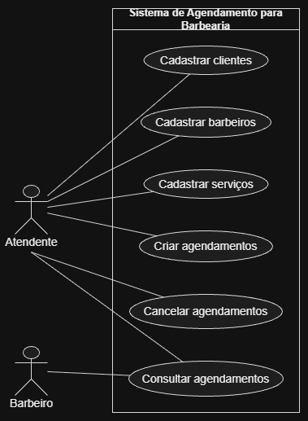

# 4.2.2 Modelagem de Casos de Uso

## Atores

| Ator | Quem é | O que faz no sistema |
|---|---|---|
| Barbeiro | Profissional responsável pelos atendimentos | Cadastra clientes, barbeiros e serviços, cria e consulta agendamentos e pode cancelar agendamentos |
| Atendente | Pessoa responsável pela organização dos horários, quando houver | Cadastra clientes, cria, consulta e cancela agendamentos |

## Casos de uso

| Caso de uso | Ator | Atende |
|---|---|---|
| Cadastrar cliente | Barbeiro / Atendente | RF01 |
| Cadastrar barbeiro | Barbeiro | RF02 |
| Cadastrar serviço | Barbeiro | RF03 |
| Criar agendamento | Barbeiro / Atendente | RF04 |
| Consultar agendamentos | Barbeiro / Atendente | RF05 |
| Cancelar agendamento | Barbeiro / Atendente | RF06 |

## Diagrama de casos de uso

**Figura 1 – Diagrama de casos de uso do Sistema de Agendamento para Barbearia**

Fonte: Autoria própria (2026).

O diagrama apresenta os atores Barbeiro e Atendente fora da fronteira do sistema e os casos de uso dentro dela. Os casos representam as funções definidas nos requisitos funcionais do sistema. O Barbeiro possui acesso às funções relacionadas aos cadastros e aos agendamentos, enquanto o Atendente atua principalmente no cadastro de clientes e na organização dos agendamentos.

## Especificação do caso de uso principal

O caso de uso **Criar agendamento** foi escolhido como principal porque o objetivo central do sistema é organizar os horários dos atendimentos da barbearia e reduzir conflitos de agendamento.

| Campo | |
|---|---|
| Caso de uso | Criar agendamento |
| Ator | Barbeiro / Atendente |
| Pré-condição | Cliente, barbeiro e serviço devem estar cadastrados no sistema |
| Pós-condição | O agendamento fica registrado com cliente, barbeiro, serviço, data e horário |

**Fluxo principal**

1. O ator informa o cliente que deseja realizar o atendimento.
2. O sistema identifica o cliente cadastrado.
3. O ator informa o barbeiro e o serviço desejados.
4. O sistema identifica o barbeiro e o serviço cadastrados.
5. O ator informa a data e o horário desejados.
6. O sistema verifica se o horário está disponível para o barbeiro.
7. O sistema registra o agendamento.
8. O sistema confirma o agendamento realizado.

**Fluxo alternativo**

- **A1, no passo 6: o horário informado não está disponível.** O ator informa outra data ou horário e o fluxo volta ao passo 5.

**Fluxos de exceção**

- **E1, no passo 2: o cliente informado não está cadastrado.** O sistema informa que o cliente não foi encontrado e o caso termina sem o agendamento.
- **E2, no passo 4: o barbeiro ou o serviço informado não está cadastrado.** O sistema informa que os dados não foram encontrados e o caso termina sem o agendamento.

## Rastreabilidade com a 4.2.1

| Requisito | Caso de uso | Onde aparece |
|---|---|---|
| RF01 Cadastrar cliente | Cadastrar cliente | Elipse Cadastrar cliente e pré-condição do caso principal |
| RF02 Cadastrar barbeiro | Cadastrar barbeiro | Elipse Cadastrar barbeiro e pré-condição do caso principal |
| RF03 Cadastrar serviço | Cadastrar serviço | Elipse Cadastrar serviço e pré-condição do caso principal |
| RF04 Criar agendamento | Criar agendamento | Elipse Criar agendamento e fluxo principal |
| RF05 Consultar agendamentos | Consultar agendamentos | Elipse Consultar agendamentos |
| RF06 Cancelar agendamento | Cancelar agendamento | Elipse Cancelar agendamento |

Todo requisito funcional possui um lugar nos casos de uso e toda elipse está relacionada a um requisito da 4.2.1. A especificação detalhou a necessidade de verificar a disponibilidade do horário antes de registrar o agendamento. Essa verificação surgiu ao detalhar o fluxo e deve ser considerada como uma regra do sistema.
