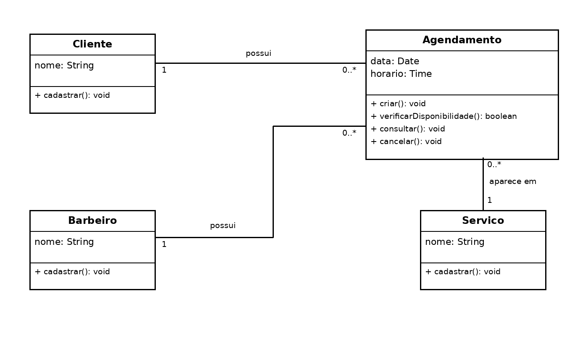

# 4.2.3 Modelagem de Classes

## Dos substantivos às classes

| Substantivo | De onde veio | Vira | Por quê |
|---|---|---|---|
| cliente | passo 1 e RF01 | classe Cliente | O sistema precisa guardar os dados do cliente |
| barbeiro | passos 3 e 6 e RF02 | classe Barbeiro | O sistema precisa identificar o profissional e seus agendamentos |
| serviço | passo 3 e RF03 | classe Servico | O sistema precisa guardar os serviços oferecidos |
| agendamento | passos 7 e 8 e RF04 | classe Agendamento | O sistema precisa registrar cada horário marcado |
| data | passo 5 | atributo de Agendamento | É uma informação do agendamento |
| horário | passos 5 e 6 | atributo de Agendamento | É uma informação do agendamento usada para verificar disponibilidade |

## Classes

| Classe | Atributos | Operações | Veio de |
|---|---|---|---|
| **Cliente** | nome: String | + cadastrar(): void | passo 1, passo 2 e RF01 |
| **Barbeiro** | nome: String | + cadastrar(): void | passo 3, passo 4 e RF02 |
| **Servico** | nome: String | + cadastrar(): void | passo 3, passo 4 e RF03 |
| **Agendamento** | data: Date, horario: Time | + criar(): void, + verificarDisponibilidade(): boolean, + consultar(): void, + cancelar(): void | passos 5 a 8, RF04, RF05 e RF06 |

## Diagrama de classes

**Figura 2 – Diagrama de classes do Sistema de Agendamento para Barbearia**

Fonte: Autoria própria (2026).

O Cliente pode possuir nenhum ou vários agendamentos, enquanto cada Agendamento pertence a um Cliente. O Barbeiro pode possuir nenhum ou vários agendamentos, enquanto cada Agendamento possui um Barbeiro responsável. Um Serviço pode aparecer em nenhum ou vários agendamentos, enquanto cada Agendamento possui um Serviço. Não há herança porque nenhuma das quatro classes é um tipo de outra. Também não há relação de composição ou agregação, pois Cliente, Barbeiro e Serviço continuam existindo independentemente de um Agendamento ser excluído.

## Teste de objetos

Foi considerada uma situação em que um cliente agenda um corte de cabelo com um barbeiro para uma data e horário determinados.

| Objeto | Classe | Valores |
|---|---|---|
| `joao` | Cliente | nome = João |
| `carlos` | Barbeiro | nome = Carlos |
| `corte` | Servico | nome = Corte de cabelo |
| `agendamento1` | Agendamento | data = 26/10/2026, horario = 14:00 |

**Ligações:** `agendamento1` está ligado a `joao`, `carlos` e `corte`.

**O que o teste confirma**

- **Um Cliente pode possuir 0..* Agendamentos e cada Agendamento possui 1 Cliente.** A situação confirma essa multiplicidade.
- **Um Barbeiro pode possuir 0..* Agendamentos e cada Agendamento possui 1 Barbeiro.** A situação confirma essa multiplicidade.
- **Um Serviço pode aparecer em 0..* Agendamentos e cada Agendamento possui 1 Serviço.** A situação confirma essa multiplicidade.
- O teste também confirma que Cliente, Barbeiro e Serviço não dependem da existência do Agendamento e, por isso, não foi utilizada composição.

## Rastreabilidade com a 4.2.2

| Operação ou atributo | Classe | De onde veio |
|---|---|---|
| cadastrar() | Cliente | RF01 e pré-condição de Criar agendamento |
| cadastrar() | Barbeiro | RF02 e pré-condição de Criar agendamento |
| cadastrar() | Servico | RF03 e pré-condição de Criar agendamento |
| data | Agendamento | passo 5 de Criar agendamento |
| horario | Agendamento | passos 5 e 6 de Criar agendamento |
| verificarDisponibilidade() | Agendamento | passo 6 de Criar agendamento |
| criar() | Agendamento | passo 7 de Criar agendamento e RF04 |
| consultar() | Agendamento | RF05 |
| cancelar() | Agendamento | RF06 |

Toda operação possui origem em um requisito ou em um passo do caso de uso. Os passos do sistema possuem uma classe responsável. A modelagem confirmou as classes Cliente, Barbeiro, Servico e Agendamento e incorporou a operação verificarDisponibilidade(), que surgiu durante a especificação do fluxo de Criar agendamento.
